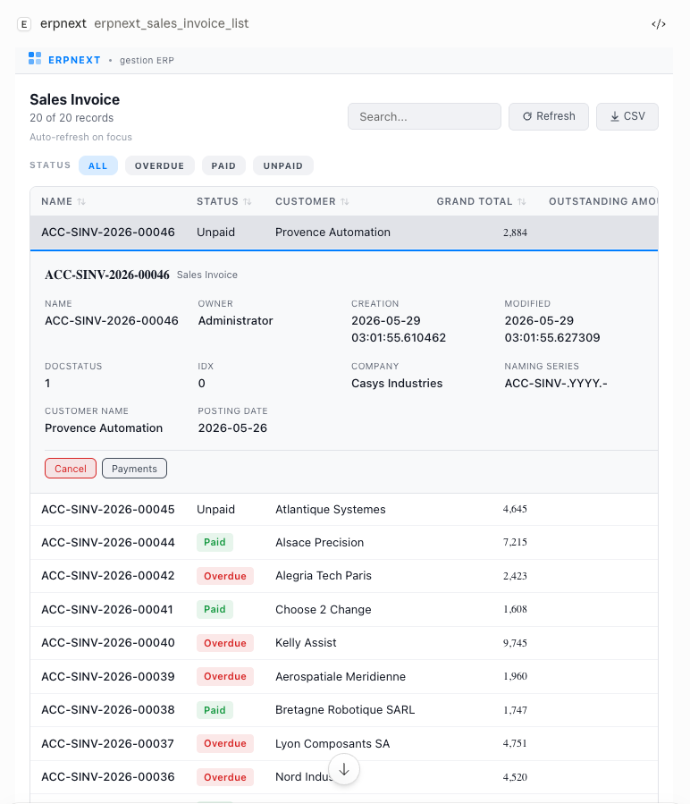
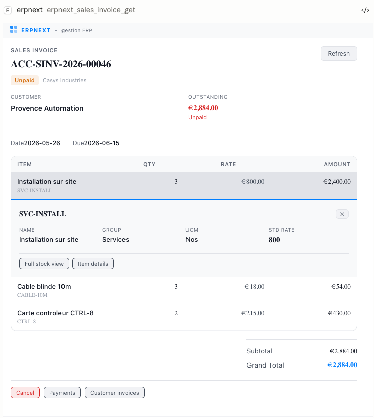
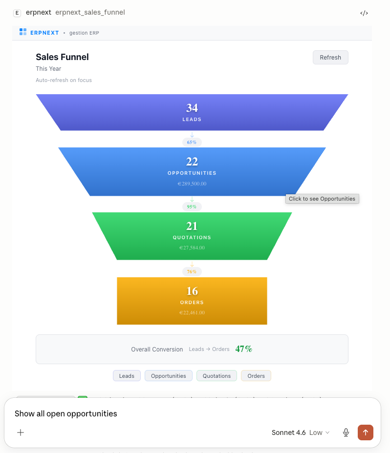
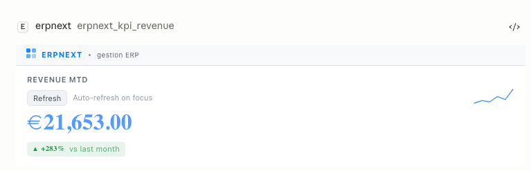
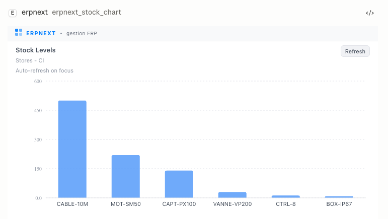
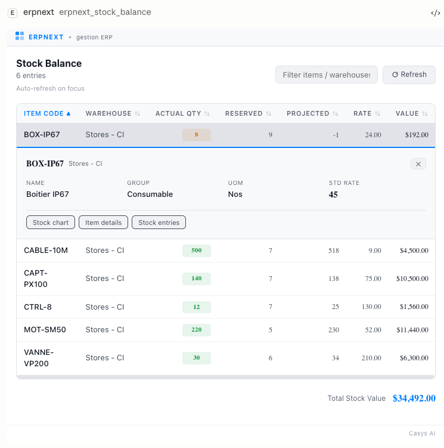
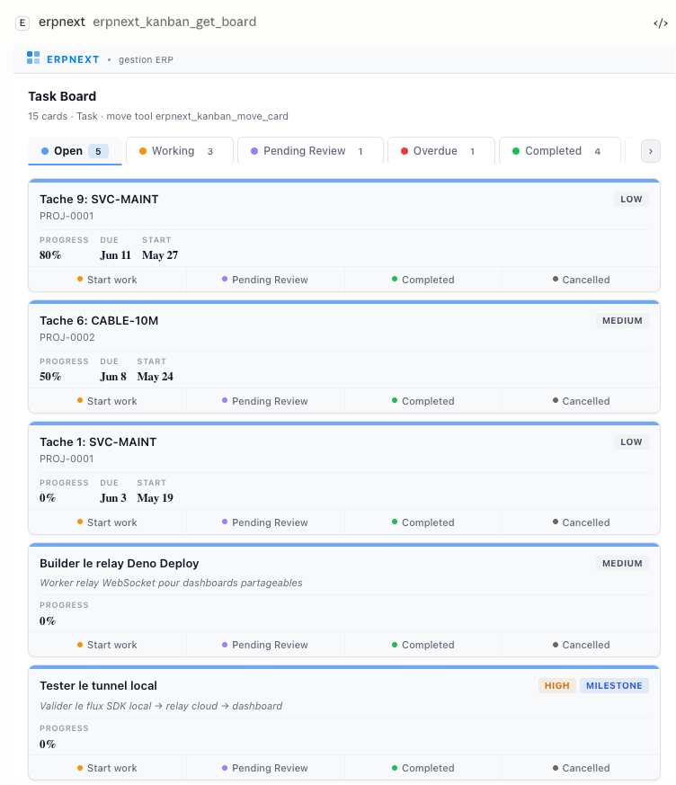
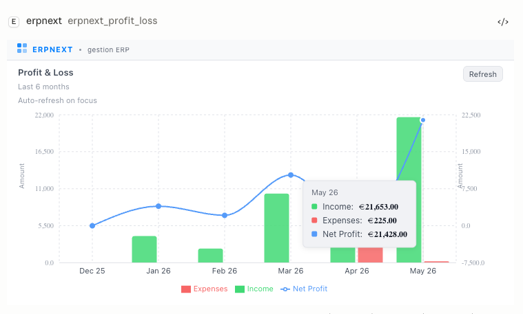

[English](README.md) | 繁體中文

# @casys/mcp-erpnext

[](https://jsr.io/@casys/mcp-erpnext)
[](https://www.npmjs.com/package/@casys/mcp-erpnext)
[](https://github.com/Casys-AI/mcp-erpnext/actions/workflows/test.yml)
[](https://modelcontextprotocol.io)
[](https://m8ven.ai/mcp/casys-ai-mcp-erpnext-1kev4k)
[](LICENSE)

> [!IMPORTANT]
> **安裝 3.3：** npm/Node 請執行 `npx -y @casys/mcp-erpnext@latest`；Deno 請執行
> `deno run -A jsr:@casys/mcp-erpnext@3.3.1/server`。3.3.1 是穩定版，並使用 npm
> 的 `latest` 標籤；預發布版本若有發布，則使用 `next` 標籤。3.3
> 為作用中情境加入分級選取：清單核取方塊、對篩選後的列全選、Shift 點選範圍與
> Ctrl/Cmd 點選切換；一至三筆選取提供精簡記錄，最多八筆提供參照，超過時改為單一
> `erpnext_doc_list`
> 查詢項目。圖表點選會吸附到所在欄最近的資料點。在取代既有部署前，請使用實際的
> MCP 主機進行測試。發布歷程請見 [CHANGELOG](CHANGELOG.md)。

讓任何相容 MCP 的 AI 智慧代理操作您的 [ERPNext](https://erpnext.com) / Frappe
執行個體 — 文件、工作流程，以及主機內的互動式檢視器（Claude Desktop、 Claude
Code、VS Code Copilot 或自訂代理）。

支援**自行託管**與 **ERPNext Cloud**（frappe.cloud）執行個體。

> 基於 **[@mcpview/server](https://github.com/mcpview/mcpview)** 構建 —
> 這是驅動本專案的 MCP 伺服器框架（並行處理、驗證、MCP Apps、可觀測性）。詳見
> [mcpview.dev](https://mcpview.dev)。

## 截圖

在 MCP 主機中渲染的互動式檢視器，完全由工具結果驅動。

<table>
  <tr>
    <td width="50%" align="center">
      <br>
      <sub><b>doclist-viewer</b> — 任何 DocType 皆可呈現為可排序的表格，含晶片篩選器及內嵌詳細面板</sub>
    </td>
    <td width="50%" align="center">
      <br>
      <sub><b>invoice-viewer</b> — 顯示交易方、明細項目、品項下鑽及提交／取消／付款功能的發票檢視器</sub>
    </td>
  </tr>
  <tr>
    <td width="50%" align="center">
      <br>
      <sub><b>funnel-viewer</b> — 潛在客戶 → 商機 → 報價 → 訂單，含轉換率</sub>
    </td>
    <td width="50%" align="center">
      <br>
      <sub><b>kpi-viewer</b> — 大數字 KPI，含與上期對比的差異值及走勢迷你圖</sub>
    </td>
  </tr>
  <tr>
    <td width="50%" align="center">
      <br>
      <sub><b>chart-viewer</b> — 通用 Recharts 渲染器（範例：庫存水位）</sub>
    </td>
    <td width="50%" align="center">
      <br>
      <sub><b>stock-viewer</b> — 庫存結餘，含色碼數量標籤</sub>
    </td>
  </tr>
  <tr>
    <td width="50%" align="center">
      <br>
      <sub><b>kanban-viewer</b> — 可讀寫的看板（Task / Opportunity / Issue），含內嵌編輯</sub>
    </td>
    <td width="50%" align="center">
      <br>
      <sub><b>chart-viewer</b> — 複合雙軸圖表（範例：損益表）</sub>
    </td>
  </tr>
</table>

## 最新異動

**3.2.0 是目前的穩定版。** 九個檢視器皆可在檢視器內導覽，並提供返回與麵包屑
導覽；已確認的文件異動會把衍生的層級標記為過期，直到重新讀取為止。作用中內容
選取涵蓋各互動式檢視器，圖表、KPI 與巢狀圖表的詳細資料可透過可見按鈕開啟，
方便觸控螢幕使用。通用文件檢視器、子表格與附件流程依循 ERPNext 自身的 DocType
中繼資料。工具選取篩選器（`ERPNEXT_CATEGORIES`、`ERPNEXT_EXCLUDE_CATEGORIES`、
`ERPNEXT_EXCLUDE_TOOLS`）可限制部署所公開的工具；未宣告支援 MCP Apps
的用戶端無法下載附件；錯誤採結構化格式。檢視器專用的附加資料（重新整理請求、
導覽跳轉、工具清單）改經 `_meta` 傳遞，不再進入模型的上下文。

3.2.0 同時納入穩定版 3.0.5 與 3.1.0 的建立錯誤修復指引、ERPNext 16
商機相容性、日期、KPI 百分比及銷售漏斗幣別修正。所有功能仍依 MCP 主機能力啟用；
Buy 證據不會執行採購，也不代表即時 ERP 已通過驗證。

npm 穩定版請使用 `@casys/mcp-erpnext@latest`；Deno 請使用
`jsr:@casys/mcp-erpnext@3.3.1/server`。

完整的發布歷程請參閱
[CHANGELOG](CHANGELOG.md)，目前版本的重點說明請參閱[最新發布](https://github.com/Casys-AI/mcp-erpnext/releases/latest)。

[3.0 至 3.1 遷移指南](docs/migration-3.0-to-3.1.md) 說明原始碼的契約、
主機需求與部署限制，亦適用於從 3.0 或穩定版 3.1.0 升級至 3.2。

## 文件

依照 [Diátaxis](https://diataxis.fr) 依「你正在做什麼」分類：

|                       |                                                                                                                                                                                                                                                 |
| --------------------- | ----------------------------------------------------------------------------------------------------------------------------------------------------------------------------------------------------------------------------------------------- |
| **學習** — 第一次接觸 | [第一次工具呼叫](docs/tutorial-first-tool-call.md) — 四個步驟，從零到看見回應                                                                                                                                                                   |
| **執行** — 有明確目標 | [建立主檔資料](docs/fresh-instance-setup.md) · [執行 HTTP 伺服器](docs/http-deployment.md) · [設定 OAuth](docs/oauth-setup.md) · [從 3.0 遷移至 3.1](docs/migration-3.0-to-3.1.md) · [遷移至 2026-07-28](docs/migration-mcp-spec-2026-07-28.md) |
| **查閱**              | [工具](docs/tools.md) · [環境變數](docs/environment-variables.md) · [DocType 涵蓋範圍](docs/coverage.md) · [儲存庫結構](docs/architecture.md)                                                                                                   |
| **理解原理**          | [設計概念](docs/concepts.md) — 連結解析、傳輸方式、MRTR，以及各層快取的差異                                                                                                                                                                     |

## 快速開始

### 前置條件

在 ERPNext 中產生 API 憑證：

1. 登入 ERPNext → 右上角選單 → **My Settings**
2. **API Access** 區段 → **Generate Keys**
3. 複製 `API Key` 與 `API Secret`

### Claude Desktop / Claude Code（npm）

```json
{
  "mcpServers": {
    "erpnext": {
      "command": "npx",
      "args": ["-y", "@casys/mcp-erpnext"],
      "env": {
        "ERPNEXT_URL": "http://localhost:8000",
        "ERPNEXT_API_KEY": "your-api-key",
        "ERPNEXT_API_SECRET": "your-api-secret"
      }
    }
  }
}
```

> **支援 ERPNext Cloud** — 將 `ERPNEXT_URL` 設定為您的 Frappe Cloud URL（例如
> `https://mycompany.erpnext.com` 或 `https://mysite.frappe.cloud`）。API
> 金鑰驗證在自行託管與雲端執行個體上的操作方式相同。

### VS Code Copilot

新增至 `.vscode/mcp.json`：

```json
{
  "servers": {
    "erpnext": {
      "type": "stdio",
      "command": "npx",
      "args": ["-y", "@casys/mcp-erpnext"],
      "env": {
        "ERPNEXT_URL": "http://localhost:8000",
        "ERPNEXT_API_KEY": "your-api-key",
        "ERPNEXT_API_SECRET": "your-api-secret"
      }
    }
  }
}
```

### Deno（stdio）

```json
{
  "mcpServers": {
    "erpnext": {
      "command": "deno",
      "args": ["run", "--allow-all", "server.ts"],
      "env": {
        "ERPNEXT_URL": "http://localhost:8000",
        "ERPNEXT_API_KEY": "your-api-key",
        "ERPNEXT_API_SECRET": "your-api-secret"
      }
    }
  }
}
```

### HTTP 模式

若需要多個用戶端共用一個常駐伺服器，而非每個用戶端各自啟動一個行程：
[如何執行 HTTP 伺服器](docs/http-deployment.md)。 請注意，3.0.0 對 2026 年前的
HTTP 用戶端屬於破壞性變更。

### 類別篩選

僅載入您所需的類別：

```bash
npx -y @casys/mcp-erpnext --categories=sales,inventory
```

另支援排除類別或個別工具，並可使用對應的環境變數：

```bash
deno run -A server.ts --categories=sales,inventory,operations --exclude-tools=erpnext_file_upload,erpnext_doc_delete
```

CLI 值會分別覆寫 `ERPNEXT_CATEGORIES`、`ERPNEXT_EXCLUDE_CATEGORIES` 與
`ERPNEXT_EXCLUDE_TOOLS`。被排除的工具無法呼叫，也不會出現在檢視器操作或快取
預熱中。請使用 `--flag=value`；無效的排除條件或最終沒有工具時會阻止啟動。
完整規則請見[工具選擇](docs/environment-variables.md#tool-selection)。

## 全新執行個體設定

全新的 ERPNext 執行個體沒有主檔資料，因此業務工具會因驗證失敗而無法使用。
請見[為全新 ERPNext 執行個體建立主檔資料](docs/fresh-instance-setup.md)。

## UI 檢視器

九個互動式 [MCP Apps](https://github.com/modelcontextprotocol/ext-apps)
檢視器，已登錄為 `ui://mcp-erpnext/{name}`：

| 檢視器                | 說明                                               | 互動功能                                                            |
| --------------------- | -------------------------------------------------- | ------------------------------------------------------------------- |
| `doc-viewer`          | 顯示欄位與子表格的通用 ERPNext 文件                | 依能力啟用附件、具型別導覽、受保護的提交／取消及原始 JSON。         |
| `doclist-viewer`      | 通用文件表格，支援排序、篩選、分頁與 CSV 匯出      | 內嵌詳情、具型別的巢狀導覽、提交／取消，以及精簡的狀態篩選器。      |
| `invoice-viewer`      | 含交易方、品項及合計的銷售訂單、銷售發票與報價單   | 品項、庫存、交易方與付款導覽，以及受保護的提交／取消操作。          |
| `stock-viewer`        | 含色碼數量標籤的庫存結餘表格                       | 品項詳情、近期異動、庫存圖表與庫存記錄導覽。                        |
| `chart-viewer`        | 通用圖表渲染器（透過 Recharts 支援 12 種圖表類型） | 精確的資料點／數列導覽，以及簡單與組合圖表的作用中內容選取。        |
| `kanban-viewer`       | 可讀寫的 Task、Opportunity、Issue 看板             | 拖放、內嵌編輯、循序儲存，以及具型別的相關文件導覽。                |
| `kpi-viewer`          | 含差異值、迷你圖與趨勢的大數字卡片                 | 數值與趨勢導覽，以及有上限的作用中內容選取。                        |
| `funnel-viewer`       | 含轉換率的梯形銷售漏斗                             | 保留期間條件的階段導覽，以及有上限的作用中內容選取。                |
| `buy-evidence-viewer` | 不可變的封存 Buy 證據（僅限已記錄的工作階段）      | 標示完整、部分、未解決或不可用的投影；沒有即時 ERP 重新整理或異動。 |

檢視器與 Buy 結果欄位會使用主機語言：英文、法文、簡體中文、繁體中文、印地語、
孟加拉語、泰米爾語與烏爾都語。中文的文字系統標記優先於地區標記；未指定文字
系統時，`zh-TW`、`zh-HK` 與 `zh-MO` 會使用繁體中文。烏爾都語採用由右至左
的文件方向。主機後續變更語言時，介面會更新語言與方向，無須重新載入。3.2 的 App
等待與拒絕畫面仍使用英文；這些共用畫面的主機語言支援仍待上游 MCP View 補足。

### 導覽與作用中內容

檢視器會依主機宣告的能力，逐步採用最合適的互動方式：

- `serverTools` 透過 `app.callServerTool()`，直接在目前檢視器內開啟具型別的
  清單、文件或圖表層級。麵包屑與返回導覽會還原各層級的介面狀態。
- `downloadFile` 讓主機確認並儲存以大小上限保護的內嵌附件。目前原始碼另要求 MCP
  用戶端先宣告 MCP Apps 擴充功能與 HTML MIME 類型，才會提供檔案內容。
  檢視器不會直接開啟 ERPNext 的檔案 URL。
- `updateModelContext` 可將圖表、KPI 與漏斗中的選取項目加入有上限的作用中內容。
  精簡的內容晶片最多保留八個項目，並可逐項移除或全部清除。傳送的快照只包含
  使用者選取的值，不含給模型的隱藏指令。
- 無法直接導覽或更新內容時，`message.text` 會保留 `app.sendMessage()` 作為
  對話式後備方式。
- 主機未提供上述能力時，仍可使用本機檢視功能，不支援的遠端操作則不會顯示。
- Buy 證據檢視器僅接受已記錄的工作階段，不會呼叫伺服器工具、重新整理即時文件
  或異動 ERP 狀態。

伺服器會提供具型別的導覽後設資料，以及各檢視器實際可呼叫的
`_availableTools`，因此在類別篩選的部署中不會顯示未載入的工具。

### 重新整理模式

唯讀檢視器會在重新取得焦點或使用重新整理控制項時重新驗證。資料異動後只會
透過明確的唯讀工具讀回已提交狀態，不會自動重播寫入工具。若較新的主機資料或
異動結果已生效，較舊或重疊的重新整理回應會被忽略。
已確認的文件異動會把目前導覽堆疊中可能衍生的快照標記為過期；只有在該畫面
實際重新讀取後才會移除標記。3.2 不會自動同步彼此分離的 MCP Apps。

### 建置 UI 檢視器

```bash
cd src/ui
npm ci
node build-all.mjs
```

開發時，可在儲存庫根目錄執行 `deno task ui:dev-host`。
[本機測試主機](src/ui/dev-host/README.md) 使用實際的本機 MCP 伺服器及其建置後的
檢視器，並自動重新建置及載入，無須重新啟動桌面用戶端。 開啟
`http://127.0.0.1:5177/?viewer=doclist` 即可查看 ERPNext 的實際公司清單。
此主機會記錄檢視器送出的上下文更新，但沒有連接模型或對話；模型是否使用
上下文，以及對話操作是否正常，仍須在桌面主機驗證。

## Buy 證據擷取

**一個**唯讀工具與**一個**已記錄的 App。它們不會採購、建立 BOM／RFQ／PO、
重新整理即時文件、取代通用 ERP 檢視器，或驗證即時 ERPNext 執行個體。

- 工具：`erpnext_buy_capture`。僅限封閉的 DocType 集合：Item、BOM、Item Price、
  Supplier Quotation、Supplier、Price List、UOM、Currency Exchange。兩次繞過
  快取的讀取必須具有相同的 `modified` 與封閉投影指紋，才會回傳暫時性的 標準化
  JSON、SHA-256 與位元組數。呼叫者不能傳入 `sourceInstance`、URL、
  憑證、`capturedAt` 或摘要。Digital Thread 把這些位元組存入自己的 CAS；
  此伺服器不另存一份 CAS。
- App：`io.casys.mcp-erpnext.buy-evidence`，App 版本為 `3.1.0`，
  與套件版本獨立。資源為 `ui://mcp-erpnext/buy-evidence-viewer`
  （`text/html;profile=mcp-app`），manifest 為
  `ui://mcp-erpnext/buy-evidence-manifest`（`application/json`）。只接受
  `viewer.session.apply`。完整、部分、未解決或不可用的投影會持續標示；沒有 即時
  DocViewer 重新整理、異動或 `app.callServerTool`。工作階段 `anchor` 指向封存的
  Digital Thread 產物（`provenance.bundleRef`），不是顯示投影的雜湊。
- 結果 `/2.0` 保留有上限的 `excludedLines`：未列入已定價明細的選定行 ID、
  數量、單位與原因。它不含金額、幣別或價格來源；已涵蓋的小計維持封存值，
  未解決明細仍會顯示。記錄結果 `/1.0` 也繼續接受。
- 檢視器與其他 MCP Apps 一起建置。JSR/npm 發布產物會包含建置完成的 HTML 與 Buy
  TypeScript 模組；manifest 使用同一套 App 身分。

Digital Thread 負責組態與封存（`buy-configuration/1.0`、`buy-cost-bundle/1.0`、
`buy.capture-configuration-cost@1`、`buy.seal-configuration-cost@1`）。派送前
必須具有已驗證的 `commerce.read-erpnext-buy-source@1` 綁定。

## 工具

資料列表類的 `_list` 工具會透過 doclist-viewer 返回互動式結果，支援點擊列、
內嵌詳情及跨檢視器導覽；專用於附件的 `erpnext_file_list` 不會呈現
doclist-viewer。通用與專用的文件讀取會使用 doc-viewer，但銷售訂單、銷售發票及
報價單仍保留專用的 invoice-viewer。

- **Sales（銷售）** — 客戶、銷售訂單、發票及報價單，含完整的 CRUD、提交與取消。
- **Purchasing（採購）** — 供應商、採購訂單、採購發票、收貨單及供應商報價單。
- **Inventory（庫存）** — 品項、庫存結餘、倉庫及庫存記錄。
- **Accounting（會計）** — 科目表、日記帳分錄及付款記錄。
- **HR（人資）** — 員工、出勤、請假申請、薪資單、薪資處理及費用申報。
- **Project（專案）** — 專案、任務（含原生指派）及工時單。
- **Delivery（出貨）** — 出貨單及貨運單。
- **Manufacturing（製造）** — 物料清單（BOM）、工單及工作卡。
- **CRM** — 潛在客戶、商機、聯絡人及行銷活動。
- **Assets（資產）** — 資產、異動、維護紀錄及類別。
- **Operations（作業）** — 通用 CRUD、原生指派、附件清單、上傳、由主機代理下載，
  以及預設拒絕的 Frappe 方法呼叫（`erpnext_doc_*`、`erpnext_file_*`、
  `erpnext_method_call`）。
- **Kanban（看板）** — 支援拖放的 Task、Opportunity、Issue 可讀寫看板。
- **Analytics（分析）** — 圖表（長條圖、面積圖、樹狀圖、雷達圖、散佈圖、損益表
  等）、含迷你圖的 KPI，以及銷售漏斗。
- **Buy** — 商業文件的唯讀封存擷取（`erpnext_buy_capture`），以及不可變的
  已記錄工作階段證據檢視器；不會採購、建立 BOM／RFQ／PO，或驗證即時 ERP。
- **Setup（設定）** — 公司建立及可指派使用者清單。

完整的各工具參數說明請參閱 [`docs/tools.md`](docs/tools.md)。

## 環境變數

| 變數                         | 必填 | 說明                                                                                                      |
| ---------------------------- | ---- | --------------------------------------------------------------------------------------------------------- |
| `ERPNEXT_URL`                | 是   | ERPNext 基礎 URL — 自行託管（例如 `http://localhost:8000`）或雲端（例如 `https://mycompany.erpnext.com`） |
| `ERPNEXT_API_KEY`            | 是   | 來自使用者設定的 API Key                                                                                  |
| `ERPNEXT_API_SECRET`         | 是   | 來自使用者設定的 API Secret                                                                               |
| `ERPNEXT_MAX_UPLOAD_BYTES`   | 否   | 解碼後檔案上傳大小上限（正整數位元組；預設 10 MiB）                                                       |
| `ERPNEXT_MAX_DOWNLOAD_BYTES` | 否   | 附件下載大小上限（正整數位元組；預設 10 MiB）                                                             |
| `ERPNEXT_METHOD_ALLOWLIST`   | 否   | 以逗號分隔的完整方法路徑或 `prefix.*`；未設定時 `erpnext_method_call` 會拒絕所有方法，`*` 則允許全部      |
| `MCP_MRTR_SIGNING_KEY`       | 否   | 恰為 64 個小寫十六進位字元；啟用已簽章的模糊連結 elicitation。**僅限單一執行個體部署**，詳見下方說明      |

MRTR 為選用功能。未設定此金鑰，或用戶端未宣告 elicitation
時，模糊連結會維持既有的 可操作歧義錯誤，而不會要求選擇。

> **請勿在負載平衡器後方使用此設定執行 MRTR。** 簽章金鑰只證明重試權杖為真，
> 並不使其只能使用一次；後者是 replay store 的職責，而預設的 replay store
> 僅在單一行程內有效。若兩個執行個體共用金鑰，同一個已簽章的重試會在兩邊
> 都通過驗證，導致採購單、請假單或費用報銷單被**建立兩次**，且一經提交即
> 無法復原。
>
> 多執行個體部署必須將共用且具原子性的 `mrtr.replayStore` 傳入 `McpApp` （Redis
> 可用 `SET key 1 NX EXAT` 滿足此契約）。啟用 MRTR 而未提供時，
> 框架會在啟動時記錄警告——該警告並非雜訊，正是本段所述的問題。

## 架構

工具依業務領域分組於 `src/tools/`，Frappe REST 用戶端不含任何相依套件， 每個 UI
檢視器則是 `src/ui/` 下的獨立建置。完整結構請見
[儲存庫結構](docs/architecture.md)。

## npm 套件

npm 套件（`@casys/mcp-erpnext`）是一個完全自包含的套件，無任何執行時相依套件。UI
檢視器已內嵌其中。需要 Node >= 20。

## 貢獻

歡迎貢獻 — 請參閱 **[CONTRIBUTING.md](CONTRIBUTING.md)** 以開始，並參閱
[AGENTS.md](AGENTS.md) 了解完整的架構與慣例。

## 授權條款

MIT
